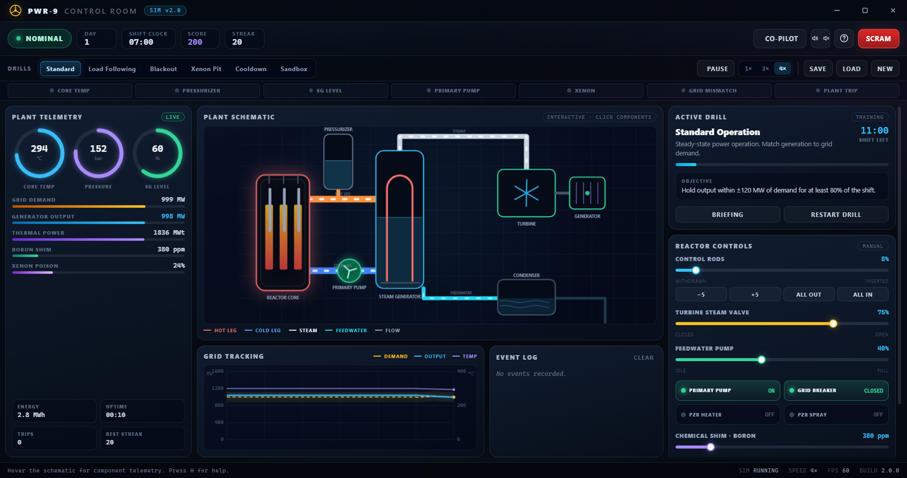

# PWR-9 · Nuclear Reactor Simulator

An interactive pressurized-water-reactor control room for the desktop. Match grid
demand with stable generation, keep the primary loop inside its safety envelope,
and work through six drills — from steady-state operation to a full station
blackout.

Built with vanilla HTML/CSS/JS on Electron. No frameworks, no network access, no
telemetry.

## Download

[**Download the portable Windows build**](https://github.com/venkatesh09101994/nuclear-reactor-simulator/releases/latest)
— no installer and no admin rights required.



## Run

```bash
npm install
npm start
```

## Build the portable Windows app

```bash
npm run dist
```

The self-contained executable is written to `dist/NuclearReactorSimulator.exe`.
It needs no installer and no admin rights.

## Drills

| Drill | Challenge |
| --- | --- |
| Standard Operation | Hold output within ±120 MW of demand for 80% of the shift. |
| Load Following | Track a fast, volatile grid profile for 70% of the shift. |
| Station Blackout | Restart the primary pump and export 800 MW after losing off-site power. |
| Xenon Pit Recovery | Recover 700 MW from a xenon-poisoned core. |
| Emergency Cooldown | Bring a tripped plant below 120 °C and 60 bar. |
| Sandbox | No objective — operate freely and chase a high score. |

## Controls

| Input | Action |
| --- | --- |
| Drag the sliders | Control rods, turbine steam valve, feedwater, boron |
| Space | Pause / resume |
| S | SCRAM |
| P | Primary coolant pump |
| G | Grid breaker |
| R | Reset trip (when cool and depressurised) |
| A | Co-pilot (autopilot) |
| M | Mute / unmute |
| H | Operations manual |
| F | Fullscreen |
| 1 – 6 | Select drill |
| Click a schematic component | Inspect / toggle it |
| Click an annunciator tile | Acknowledge the alarm |

## Safety envelope

- Core temperature: warning above 322 °C, automatic trip at 350 °C.
- Primary pressure: warning above 168 bar, trip at 180 bar.
- Steam generator: warning below 30%, trip at 5% while the core is at power.
- Trip reset unlocks below 250 °C and 165 bar.
- Decay heat keeps the core warm after shutdown — keep the pump running and open
  the steam valve to remove it.

## Development

```bash
npm run verify
```

`npm run verify` boots the real UI in Electron, drives every control, asserts
layout/canvas/state behaviour, and writes screenshots to `verify-shots/`.

Progress autosaves to `%APPDATA%/Nuclear Reactor Simulator/savegame.json`;
window size and position are restored between sessions.
